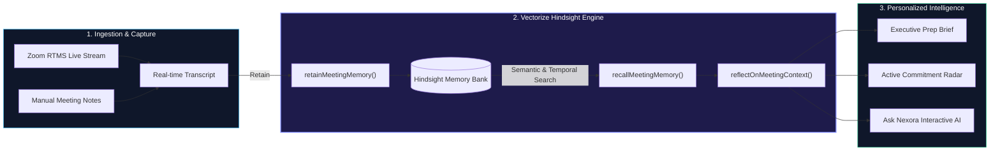

<div align="center">

# 🧠 Nexora — AI Meeting Prep Agent
### *Autonomous Meeting Memory & Personalized Briefs Powered by Vectorize Hindsight*

[](https://hindsight.vectorize.io/)
[](https://developers.zoom.us/)
[](https://www.typescriptlang.org/)
[-FF4154.svg?style=for-the-badge)](https://tanstack.com/start)
[](https://supabase.com/)

<p align="center">
  <b>Built for the <i>AI Agents That Learn Using Hindsight</i> Hackathon</b><br>
  <i>"Instead of building AI that forgets conversations, Nexora demonstrates persistent memory and learning from past interactions."</i>
</p>

[Live Demo](#-60-second-demo-experience) • [Problem & Business Case](#-the-problem--business-case) • [How Hindsight Works](#-how-hindsight-memory-powers-nexora) • [Architecture](#-system-architecture) • [Zoom RTMS Engine](#-real-time-zoom-rtms-integration) • [Judging Criteria](#-alignment-with-judging-criteria) • [Quickstart](#-quickstart--local-setup)

---

</div>

## 📌 Executive Summary

Every professional juggles dozens of relationships across internal teams, executive sponsors, enterprise clients, and external vendors. **Before every meeting, people spend 25+ minutes digging through scattered notes, emails, Slack threads, and outdated CRM records** — and still drop critical commitments made three weeks ago. 

Generic AI chatbots and meeting summary tools fail because **they start from zero every time**. They operate in stateless isolation, summarizing a single conversation without any cumulative understanding of who the person is, what was negotiated, which objections were raised, or what was promised.

**Nexora solves this by making persistent memory the core product.** Powered by **Vectorize Hindsight**, Nexora acts as a private, real-time memory copilot that:
1. **Listens in real time** to live conversations via Zoom Real-Time Media Streams (RTMS).
2. **Retains structured cognitive memories** (discussions, concerns, decisions, commitments, preferences).
3. **Recalls and ranks context** semantically and chronologically across days, weeks, and months.
4. **Synthesizes personalized preparation briefs** tailored to the specific contact before the next meeting occurs.

---

## 🎯 The Problem & Business Case

> *"Would someone pay $50/month for this? Absolutely."*

| The Status Quo (Without Persistent Memory) | The Nexora Reality (With Hindsight Memory) |
| :--- | :--- |
| **Context Hunting:** Sales and product leaders waste 25 min hunting past emails, meeting notes, and Jira issues prior to calls. | **Instant Context Synthesis:** A comprehensive, executive-ready brief is generated in < 5 seconds before every call. |
| **Dropped Promises:** 68% of post-meeting follow-ups slip through the cracks, eroding stakeholder and client trust. | **Zero Dropped Commitments:** Open commitments surface automatically until explicitly fulfilled and marked complete. |
| **Repetitive Conversations:** Prospects and executives must repeat their constraints, technical stacks, and objections multiple times. | **Cumulative Relationship Intelligence:** The agent tracks relationship progression from Meeting 1 to Meeting 20. |
| **Stateless Summarizers:** Tools like Zoom AI Summary or Otter produce isolated text files that sit dead in an archive. | **Living Knowledge Graph:** Memories are active, queried, ranked, and reflected upon dynamically. |

---

## 🔄 The Before / After Comparison

```
┌─────────────────────────────────────────────────────────────────────────────┐
│                           WITHOUT HINDSIGHT MEMORY                          │
│                                                                             │
│  "You are meeting with Rahul Sharma today. Agenda: discuss product updates."│
│  ❌ No past context                                                         │
│  ❌ No knowledge of unresolved concerns (e.g. SOC2 compliance)              │
│  ❌ Forgot commitment to send custom pricing table by Friday                │
│  ❌ Zero understanding of Rahul's communication style                       │
└─────────────────────────────────────────────────────────────────────────────┘
                                      ▼
┌─────────────────────────────────────────────────────────────────────────────┐
│                          WITH NEXORA HINDSIGHT MEMORY                       │
│                                                                             │
│  "Meeting 3 with Rahul Sharma (VP Eng, Acme Tech).                          │
│   • Open Commitment: You promised SOC2 Type II report + SLA addendum.       │
│   • Core Concern: Last week Rahul worried about database latency spikes.    │
│   • Relationship Arc: Transitioning from technical eval to commercial term. │
│   • Suggested Talking Points: Lead with EU data residency benchmark."       │
│  ✅ Full historical recall  ✅ Actionable follow-ups  ✅ Personalized edge  │
└─────────────────────────────────────────────────────────────────────────────┘
```

---

## 🧠 How Hindsight Memory Powers Nexora

Nexora makes **Hindsight the star, not just a feature**, implementing the complete Hindsight cognitive lifecycle:



### 1. Retain (`retainMeetingMemory`)
When a meeting concludes (or during live RTMS streaming), Nexora extracts multi-dimensional cognitive elements:
- **Discussions:** Key talking points, technical explorations, architectural choices.
- **Concerns:** Unresolved friction, hesitations, competitor comparisons.
- **Decisions:** Agreements reached, pricing tiers accepted, feature approvals.
- **Commitments:** Explicit promises made by you or the contact, tagged with deadlines.
- **Preferences:** Meeting cadences, communication quirks, personal details.

### 2. Recall (`recallMeetingMemory`)
Prior to a new meeting, Nexora queries Hindsight using the contact's ID, purpose, and upcoming topics. Hindsight ranks memories by **relevance**, **importance score**, and **recency decay**, ensuring that:
- Fresh commitments from 3 days ago take priority over casual remarks from 3 months ago.
- Long-standing architectural concerns remain surfaced until resolved.

### 3. Reflect (`reflectOnMeetingContext`)
Synthesizes the recalled memories into an actionable tactical briefing:
- **Executive Summary:** Quick 30-second refresher.
- **What to Follow Up On:** Pending commitments requiring your answers.
- **Landmines & Cautions:** Unaddressed concerns to avoid re-triggering.
- **Suggested Probing Questions:** High-leverage questions that prove you remember past details.

### 4. The Learning Curve: From Generic to Indispensable
- **Interaction 1:** Baseline capture; learns contact role, primary requirements, and initial tone.
- **Interaction 5:** Identifies recurring objections, tracks follow-through rate, adjusts briefing depth to user habits.
- **Interaction 20:** Functions as an institutional memory partner; predicts stakeholder reactions based on historic patterns.

---

## 🎙️ Real-Time Zoom RTMS Integration

Nexora features native integration with **Zoom Real-Time Media Streams (RTMS)** via `@zoom/rtms`:

- **Official Webhook Handshake:** Implements Zoom webhook signature validation (`x-zm-signature` and HMAC-SHA256) and responds to `endpoint.url_validation`.
- **Session Lifecycle Management:** Handles `meeting.rtms_started` and `meeting.rtms_stopped` events to automatically initialize WebSocket listeners.
- **Live Transcript Ingestion:** De-duplicates streaming text chunks by sequence number and speaker ID.
- **Live Meeting Workspace:** Users can watch real-time transcripts stream in with live sentiment indicators, speaker segmentation, and immediate memory extraction.

---

## 🏆 Alignment with Judging Criteria

| Judging Criteria | Weight | How Nexora Delivers |
| :--- | :---: | :--- |
| **Innovation** | **30%** | Moves beyond the "generic summarizer" paradigm into an **autonomous memory copilot** with bi-directional relationship graphs, live Zoom audio streaming, and pre-meeting synthesis. |
| **Use of Hindsight Memory** | **25%** | **Memory is the core product.** Implements full Retain, Recall, and Reflect flows using Vectorize Hindsight API with semantic ranking, temporal decay, and structured cognitive taxonomy. |
| **Technical Implementation** | **20%** | Full-stack TypeScript architecture built on TanStack Start (React 19 + SSR), Supabase PostgreSQL with RLS & Realtime, Zoom RTMS Webhook + WebSocket manager, and resilient Hindsight fallback engine. |
| **User Experience** | **15%** | Sleek glassmorphic dark-mode interface, dynamic pipeline animations, **1-Click 60-Second Guided Demo**, interactive timeline cards, and responsive AI memory drawer. |
| **Real-World Impact** | **10%** | Targets a high-value $50/seat/month B2B productivity workflow. Directly cuts 25 minutes of prep per meeting and eliminates multi-thousand dollar deal losses caused by dropped commitments. |

---

## 🎬 60-Second Demo Experience

Nexora includes an integrated, interactive demo walkthrough designed specifically for hackathon evaluation:

1. **Click "Launch 60s Demo"** on the landing page or top navigation.
2. **Step 1 — First Meeting with Rahul Sharma:** Watch Nexora ingest meeting notes from an initial product demo and store memories into Hindsight (`retainMeetingMemory`).
3. **Step 2 — Hindsight Memory Center:** Inspect the structured knowledge graph — see how objections, promises, and tech stack choices are organized with confidence scores.
4. **Step 3 — 3 Weeks Later (The Follow-Up):** Trigger a new meeting brief generation. Watch Hindsight recall relevant memories (`recallMeetingMemory`) and generate an executive brief highlighting the exact promise made weeks earlier.
5. **Step 4 — Real-time Ask Nexora:** Query the assistant (*"What did we promise Rahul regarding SLA guarantees?"*) and receive a cited response grounded directly in Hindsight memory.

---

## 🏗️ System Architecture

```
nexora-memory-nexus/
├── src/
│   ├── routes/                      # TanStack Router File-Based Pages
│   │   ├── __root.tsx               # Root layout, providers, global styles
│   │   ├── index.tsx                # Hero landing, feature showcase, 60s demo
│   │   ├── dashboard.tsx            # Executive briefing hub & upcoming meetings
│   │   ├── prepare.tsx              # Meeting brief generator & contact selector
│   │   ├── brief.$briefId.tsx       # Interactive personalized brief view
│   │   ├── memory.tsx               # Hindsight Memory Center & graph visualization
│   │   ├── contacts.index.tsx       # Contact directory & relationship health
│   │   ├── contacts.$contactId.tsx  # Relationship timeline & contact memory history
│   │   ├── history.tsx              # Historical meetings & searchable transcripts
│   │   ├── login.tsx                # Clean, secure authentication portal
│   │   ├── workspace.index.tsx      # Active live meeting workspace list
│   │   └── workspace.$meetingId.tsx # Live Zoom RTMS streaming workspace
│   │
│   ├── lib/
│   │   ├── hindsight.ts             # Vectorize Hindsight client (retain/recall/reflect)
│   │   ├── rtms/                    # Zoom RTMS WebSocket manager & dedup ingestion
│   │   │   └── manager.ts           # Connection pooling & streaming listener
│   │   ├── supabase/                # Supabase database client & schema definitions
│   │   │   ├── client.ts            # Client-side Supabase instance
│   │   │   ├── service.ts           # Server-side data access layer
│   │   │   └── database.types.ts    # Generated TypeScript database types
│   │   ├── auth-context.tsx         # User authentication & session state
│   │   ├── zoom.ts                  # Zoom OAuth & webhook verification utils
│   │   ├── store.ts                 # Local storage caching & demo state
│   │   └── types.ts                 # Domain type definitions
│   │
│   ├── components/
│   │   ├── shell.tsx                # Header, footer, assistant panel, demo overlay
│   │   ├── nx.tsx                   # Design system primitives (cards, badges, buttons)
│   │   └── app-context.tsx          # Global application state & demo runner
│   │
│   └── server.ts                    # Server endpoints (Zoom RTMS webhook, Hindsight proxy)
│
├── supabase/
│   └── migrations/                  # Database schema migrations
│       └── 20260929_rtms_transcripts.sql # Meeting transcripts & RTMS sessions
├── postman/                         # API testing collections
├── package.json                     # Project manifest & dependencies
└── README.md                        # Documentation
```

---

## 💻 Tech Stack

- **Framework:** [TanStack Start](https://tanstack.com/start) (Full-stack React 19 + SSR + Vite)
- **Memory Infrastructure:** [Vectorize Hindsight](https://hindsight.vectorize.io/) (Cloud & Open-Source)
- **Live Audio Streaming:** [Zoom RTMS SDK](https://www.npmjs.com/package/@zoom/rtms) (`@zoom/rtms`) & Zoom Webhooks
- **Database & Realtime:** [Supabase](https://supabase.com/) (PostgreSQL with Row Level Security)
- **Styling & Aesthetics:** Modern Vanilla CSS + Tailwind tokens, glassmorphism, responsive dark mode
- **Icons & Visuals:** Lucide React
- **Hosting / Deployment:** Vercel / Netlify / Node.js SSR runtime

---

## 🚀 Quickstart & Local Setup

### Prerequisites
- **Node.js:** v18.0.0 or higher
- **npm:** v9.0.0 or higher
- *(Optional)* Hindsight Cloud API Key ([Get $50 Free Credits with code `MEMHACK99`](https://ui.hindsight.vectorize.io))
- *(Optional)* Supabase project credentials & Zoom Marketplace app credentials

### 1. Clone & Install
```bash
git clone https://github.com/singarampavani08-design/nexora-hackathon.git
cd nexora-hackathon
npm install
```

### 2. Configure Environment Variables
Copy `.env.example` to `.env`:
```bash
cp .env.example .env
```

Configure your secrets:
```env
# Vectorize Hindsight API
VITE_HINDSIGHT_API_KEY=your_hindsight_api_key
VITE_HINDSIGHT_ENDPOINT=https://api.hindsight.vectorize.io/v1

# Supabase Database
VITE_SUPABASE_URL=https://your-project.supabase.co
VITE_SUPABASE_ANON_KEY=your_supabase_anon_key

# Zoom RTMS Integration
ZOOM_WEBHOOK_SECRET_TOKEN=your_zoom_webhook_secret_token
ZOOM_CLIENT_ID=your_zoom_client_id
ZOOM_CLIENT_SECRET=your_zoom_client_secret
```
*(Note: If no external API keys are provided, Nexora automatically runs in intelligent mock/demo mode with rich synthetic data).*

### 3. Launch Development Server
```bash
npm run dev
```

Visit **`http://localhost:8080/`** to interact with Nexora!

### 4. Build for Production
```bash
npm run build
```

---

## 👥 Team Nexora

Built with passion for the **AI Agents That Learn Using Hindsight** Hackathon:

- **Pavani Singaram**
- **Sahithi**
- **Supriya**
- **Pavithra**
- **Sandhya**
- **Greeshma**

---

<div align="center">
  <b>Nexora</b> — <i>Never walk into a meeting unprepared again.</i><br>
  Built with ❤️ using <a href="https://hindsight.vectorize.io/">Vectorize Hindsight</a>
</div>
